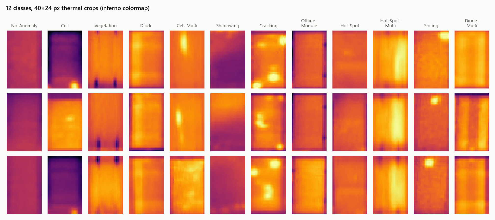
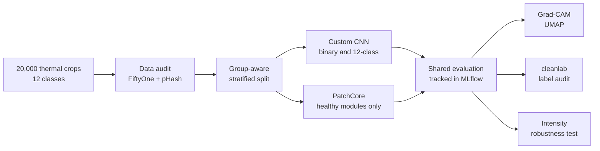
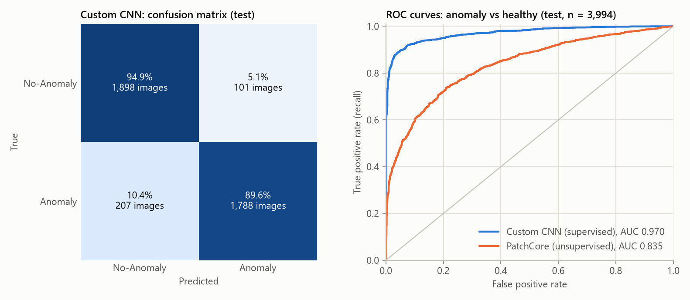
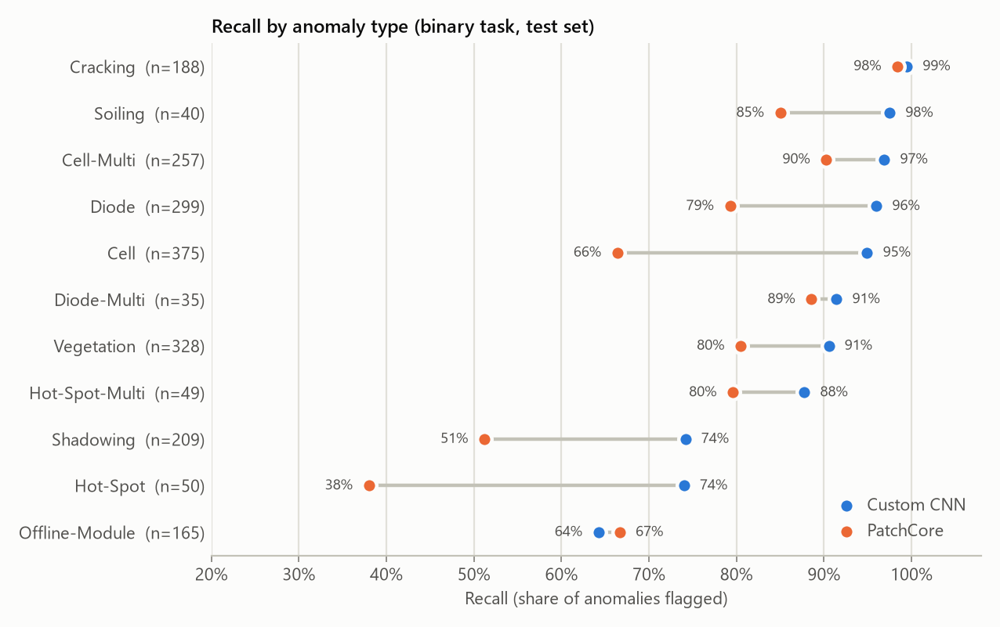
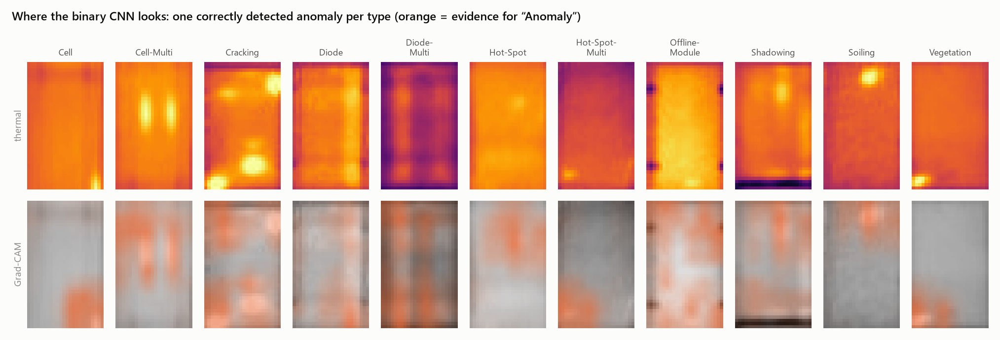
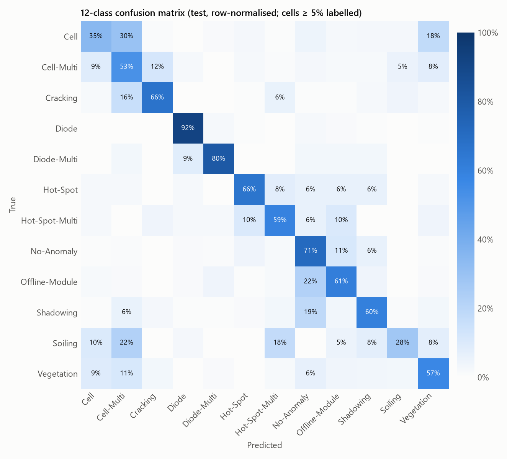
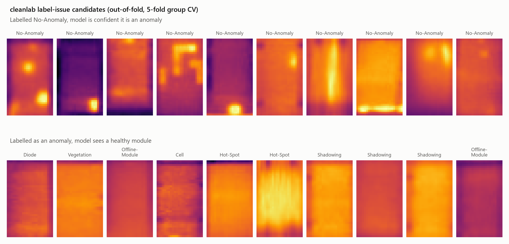
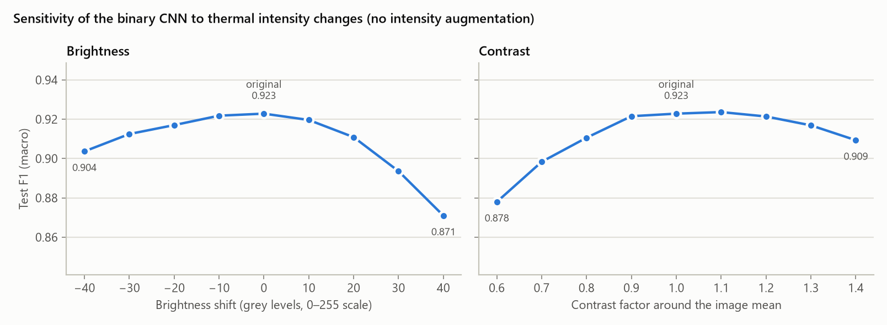

# UAV Thermal Solar Inspection

**Detecting and classifying solar-module defects in drone-captured infrared images.** The project covers the full computer-vision workflow: a dataset audit that prevents leakage, supervised and unsupervised models, shared evaluation tracked in MLflow, explainability, a label-noise audit and a robustness check.




## At a glance

| Task | Model | Test macro F1 | Test ROC AUC |
|---|---|:---:|:---:|
| Anomaly vs healthy (binary) | Custom CNN, 0.29M params, supervised | **0.923** | **0.970** |
| Anomaly vs healthy (binary) | PatchCore re-implementation, trained on healthy modules only | 0.758 | 0.835 |
| Defect type (12 classes) | Custom CNN, 0.31M params | 0.513 | 0.938 (macro one-vs-rest) |

- **Leakage-free evaluation.** Perceptual hashing found 143 groups of near-duplicate images. Each group stays inside a single split, and class proportions are kept in every split.
- **The binary detector flags 89.6% of anomalies at 94.7% precision**, using a 0.29M-parameter CNN trained at the native 40×24 resolution.
- **The errors are explained, not just counted.** Grad-CAM shows the model looking at the actual hot spots. Recall broken down by anomaly type shows which defects are missed. cleanlab estimates that **3.1% of labels are suspect**, mostly in the same classes the model struggles with.
- **A robustness check found a real weakness.** Without intensity augmentation, a +40 grey-level brightness shift drops F1 from 0.923 to 0.871. That result sets the next experiment.

## Contents

- [Context and dataset](#context-and-dataset)
- [Pipeline](#pipeline)
- [Results](#results)
  - [Binary anomaly detection](#binary-anomaly-detection)
  - [What the model looks at](#what-the-model-looks-at)
  - [12-class defect classification](#12-class-defect-classification)
  - [Label quality audit](#label-quality-audit)
  - [Robustness to thermal intensity](#robustness-to-thermal-intensity)
- [Limitations and next steps](#limitations-and-next-steps)
- [Project structure](#project-structure)
- [Reproducing the results](#reproducing-the-results)
- [Acknowledgements](#acknowledgements)

## Context and dataset

Utility-scale solar farms are inspected by drones carrying thermal cameras. A faulty cell, an activated bypass diode or a disconnected module heats up and appears as a heat signature. Reviewing tens of thousands of module crops by hand does not scale, so the goal is a model that flags anomalous modules and, ideally, names the defect.

The [InfraredSolarModules](https://github.com/RaptorMaps/InfraredSolarModules) dataset (Raptor Maps) contains **20,000 grayscale infrared crops of 40×24 px**, one solar module each. Half are healthy and the other half are split across 11 anomaly types, some of them rare:

| Class | Images | Description |
|---|---:|---|
| No-Anomaly | 10,000 | Nominal solar module |
| Cell | 1,877 | Hot spot with square geometry in a single cell |
| Vegetation | 1,639 | Panel blocked by vegetation |
| Diode | 1,499 | Activated bypass diode, typically 1/3 of the module |
| Cell-Multi | 1,288 | Hot spots with square geometry in multiple cells |
| Shadowing | 1,056 | Sunlight obstructed by vegetation, structures or adjacent rows |
| Cracking | 941 | Cracking on the module surface |
| Offline-Module | 828 | Entire module is heated |
| Hot-Spot | 251 | Hot spot on a thin-film module |
| Hot-Spot-Multi | 247 | Multiple hot spots on a thin-film module |
| Soiling | 205 | Dirt, dust or debris on the module surface |
| Diode-Multi | 175 | Multiple activated bypass diodes, typically 2/3 of the module |

## Pipeline



### 1. Data audit and leakage-free split ([eda.ipynb](notebook/eda.ipynb), [prepare_dataset.py](scripts/prepare_dataset.py))

- **Exploration in FiftyOne:** embedding UMAP, uniqueness scores and similarity search over the 20,000 images.
- **Near-duplicates:** 24 groups of 48 images share an identical perceptual hash. Linking images within a Hamming distance of 5 gives **143 groups covering 402 images (2.0%)**. Some groups mix labels. Those were checked by hand and the label differences turned out to be real, but the images may still come from the same physical panel.
- **Cleaning:** 31 true duplicates were removed after review, leaving **19,969 images**.
- **Split:** a `StratifiedGroupKFold` split keeps every similarity group inside one split while preserving class proportions. The result is **12,780 train / 3,195 validation / 3,994 test** images, each 50.1% healthy, and the script checks automatically that no image leaks between splits.

### 2. Models

**Custom CNN ([custom_cnn_binary.ipynb](notebook/custom_cnn_binary.ipynb), [custom_cnn_multi.ipynb](notebook/custom_cnn_multi.ipynb))**
- **Architecture:** three double-convolution blocks (32 → 64 → 128 channels, with BatchNorm, ReLU and max-pooling), followed by dropout and a linear head.
- **No global pooling:** the head keeps the full 5×3 spatial grid. On crops this small, *where* the heat sits is part of the signal.
- **Native resolution:** the network sees the original 40×24×1 images. An ImageNet ResNet would need ×6 upscaling, and its stride-8/16 feature maps would leave a 5×3 or 3×2 grid at the original scale, too coarse to localise a single hot cell.
- **Training:** class-weighted cross-entropy, Adam (lr 1e-3, batch 32) and horizontal/vertical flips. The checkpoint kept is the one with the best validation macro F1.

**PatchCore, re-implemented from scratch ([custom_patchnote.ipynb](notebook/custom_patchnote.ipynb))**
- **Unsupervised:** the model only sees the **6,398 healthy training images**.
- **Backbone:** a denoising convolutional autoencoder trained at native resolution produces multi-level patch features on a 10×6 grid (192 dimensions, with 3×3 local averaging).
- **Memory bank:** PCA reduces the patch features to 64 dimensions (99.6% of variance kept). A greedy k-center coreset then keeps 10% of them: **38,388 patches**.
- **Scoring:** for each test patch, an exact L2 nearest-neighbour search in faiss gives its distance to the memory bank. The image score is the largest patch distance, and the decision threshold is chosen on the validation set. Inference takes **4.2 ms per image**.

### 3. Evaluation and tracking ([train.py](scripts/train.py), [evaluation.py](scripts/evaluation.py))

All models share one evaluation module, so every MLflow run logs the same metrics under the same names: per-class precision, recall and F1, ROC AUC, the confusion matrix, a per-image predictions CSV and the exact split files. Thresholds are always chosen on validation and the test set is never used for tuning. Training runs also log gradient norms and update ratios per layer, to catch vanishing gradients or a learning rate that is too high.

## Results

### Binary anomaly detection



| Model (test set, n = 3,994) | Accuracy | Macro F1 | ROC AUC | Anomaly precision | Anomaly recall |
|---|:---:|:---:|:---:|:---:|:---:|
| **Custom CNN** | 0.923 | 0.923 | 0.970 | 0.947 | 0.896 |
| Custom CNN, cleanlab suspects removed from train | 0.923 | 0.923 | 0.968 | 0.952 | 0.891 |
| PatchCore (autoencoder backbone, unsupervised) | 0.758 | 0.758 | 0.835 | 0.760 | 0.755 |

A second run of the baseline CNN with the same configuration reached F1 0.925 and AUC 0.971. Differences of about 0.002 are therefore within run-to-run noise.



Breaking recall down by the original anomaly type shows *which* defects pass for healthy:

- **Both models catch localised, high-contrast defects:** Cracking (98–99% recall) and Cell-Multi (90–97%).
- **PatchCore misses subtle or diffuse defects.** It flags only 38% of Hot-Spot and 51% of Shadowing anomalies. These images contain no individual patch that looks unlike a healthy one, which is exactly what a nearest-neighbour patch method relies on.
- **Offline-Module is the weakest class for both models** (about 65% recall). The entire module is uniformly warm, so there is no local anomaly to find, and the signal depends on absolute brightness, which is unreliable in non-radiometric images (see [robustness](#robustness-to-thermal-intensity)). It is also the class cleanlab flags most often.

### What the model looks at



On correctly detected anomalies, Grad-CAM shows the binary CNN attending to the physically relevant regions: hot cells, the warm strip of an activated diode, crack hot spots, the soiling spot. For Offline-Module the attention spreads over the whole module, which is consistent with a module that is heated everywhere. Several of the most confident "errors" turn out to be modules labelled No-Anomaly that show a clearly visible hot spot (see the [label audit](#label-quality-audit)).

### 12-class defect classification



| Accuracy | Macro F1 | Weighted F1 | Macro ROC AUC (one-vs-rest) |
|:---:|:---:|:---:|:---:|
| 0.652 | 0.513 | 0.674 | 0.938 |

- **Best and worst classes:** Diode (F1 0.89), No-Anomaly (0.80) and Cracking (0.68) do best; Soiling (0.22), Hot-Spot (0.34) and Hot-Spot-Multi (0.36) do worst.
- **The model ranks well but decides badly.** The ROC AUC is high (0.938) while macro F1 is low. Balanced class weights (0.17 for No-Anomaly, 9.5 for Diode-Multi) push predictions towards the rare classes. Rare classes therefore get high recall but low precision (Hot-Spot: 66% recall, 23% precision), and 29% of healthy modules are predicted as some defect.
- **The confusions are physically plausible:** Cell ↔ Cell-Multi (30% of Cell images), Cell → Vegetation (18%), Offline-Module → No-Anomaly (22%) and Shadowing → No-Anomaly (19%).
- **This is a first baseline.** It trained for 15 epochs and validation F1 was still rising at the last epoch.

### Label quality audit

Each of the 19,969 images gets an **out-of-fold** prediction from a 5-fold cross-validation, with folds that respect the similarity groups. A model that has memorised a wrong label would confirm it, so each prediction comes from a model that never saw the image. These out-of-fold predictions reach F1 0.917 and AUC 0.969, in line with the held-out test. [cleanlab](https://github.com/cleanlab/cleanlab) then compares each given label with these predictions:

- **Overall health:** label health score **0.975**, with **612 candidate label issues (3.1%)**. The estimated noise is asymmetric: about 2.2% of the dataset is labelled as an anomaly but looks healthy, and about 0.9% is labelled healthy but looks anomalous.
- **Where the issues are:** candidates concentrate in **Offline-Module (17%), Hot-Spot (10%) and Shadowing (9%)**, the same types the models find hardest.
- **Removing them did not help.** Retraining without the 398 training-set candidates gave no measurable gain (F1 0.923 vs 0.923). At this noise level, the candidates are worth a human review in FiftyOne rather than automatic removal.



### Robustness to thermal intensity

The images are non-radiometric JPEGs: a grey level does not map to a fixed temperature, because it depends on the camera's auto-scaling and on ambient conditions. The data shows this. Images are not normalised per image (the typical minimum is 85–110 and the typical maximum 180–255), and within a single class the mean brightness varies with a standard deviation of 22 to 41 grey levels. Healthy modules are also darker on average (mean grey level 149, versus 152 to 184 for the defect classes). Mean brightness *alone* separates healthy from anomalous with an AUC of 0.61, a shortcut a model can learn.

To measure the impact, the trained binary CNN was evaluated on the test set with brightness and contrast shifted:



- **Performance drops:** F1 falls from 0.923 to 0.871 at +40 grey levels and to 0.878 at ×0.6 contrast.
- **The errors are biased:** brighter or more contrasted images push predictions towards "Anomaly". At +30 grey levels, the share of images predicted as anomalous rises from 47% to 52%.
- **The fix is intensity augmentation:** brightness and contrast jitter. Hue and saturation jitter are meaningless on single-channel thermal data. Offline-Module, whose signal partly depends on absolute warmth, needs watching when this is added.

## Limitations and next steps

- **Intensity augmentation:** add brightness/contrast jitter (and possibly gamma), then rerun the robustness test above to quantify the gain.
- **12-class model:** train longer with a learning-rate schedule, and try softer class weighting (inverse square root, focal loss). A two-stage design is another option: the binary detector first, then a defect-type classifier on flagged modules only.
- **Label review:** go through the 612 cleanlab candidates in FiftyOne and correct the labels rather than prune them.
- **PatchCore:** try pretrained backbones (EfficientNet-B0, or DINOv2 ViT-S/14 on upscaled crops) and per-image intensity normalisation.
- **Operating point:** in an inspection workflow, a missed defect costs more than a false alarm, so the threshold should target a required recall instead of maximum F1.
- **Statistical confidence:** run several seeds per configuration and report confidence intervals, since run-to-run differences of about 0.002 F1 are already visible.

## Project structure

```
├── notebook/
│   ├── eda.ipynb                 # FiftyOne audit, near-duplicate groups, cleaning
│   ├── custom_cnn_binary.ipynb   # binary CNN, Grad-CAM, UMAP, cleanlab audit
│   ├── custom_cnn_multi.ipynb    # 12-class CNN
│   └── custom_patchnote.ipynb    # PatchCore re-implementation (unsupervised)
├── scripts/
│   ├── prepare_dataset.py        # group-aware stratified train / val / test split
│   ├── train.py                  # training loop, best checkpoint, MLflow logging
│   ├── evaluation.py             # shared metrics and thresholding for every model
│   ├── explain.py                # Grad-CAM and embedding maps (UMAP / t-SNE / PCA)
│   ├── label_issues.py           # out-of-fold probabilities + cleanlab
│   └── readme_figures.py         # regenerates the figures in this README
├── docs/figures/                 # README figures
├── data/                         # dataset and generated splits (git-ignored)
└── pyproject.toml                # uv project, PyTorch CUDA 11.8 wheels
```

> The docstrings and comments in `scripts/` are written in French.

## Reproducing the results

```bash
# 1. Environment (Python 3.13, uv)
uv sync

# 2. Data: download 2020-02-14_InfraredSolarModules.zip from
#    https://github.com/RaptorMaps/InfraredSolarModules and extract
#    images/ and module_metadata.json into data/

# 3. Audit and cleaning: run notebook/eda.ipynb  ->  data/dataset_eda.csv

# 4. Leakage-free splits  ->  data/train.csv, val.csv, test.csv
uv run python scripts/prepare_dataset.py

# 5. Models: run notebook/custom_cnn_binary.ipynb, custom_cnn_multi.ipynb, custom_patchnote.ipynb

# 6. Browse every run, metric and artifact
uv run mlflow ui --backend-store-uri sqlite:///mlflow.db

# 7. Regenerate the README figures from the logged runs
uv run python scripts/readme_figures.py
```

**Tech stack:** PyTorch and torchvision · FiftyOne · imagehash · scikit-learn · faiss · cleanlab · pytorch-grad-cam · UMAP · MLflow · uv

## Acknowledgements

The dataset comes from Raptor Maps, [InfraredSolarModules](https://github.com/RaptorMaps/InfraredSolarModules) (MIT license), presented in *Infrared Solar Module Dataset for Anomaly Detection*, [ICLR 2020 AI for Earth Sciences Workshop](https://ai4earthscience.github.io/iclr-2020-workshop/papers/ai4earth22.pdf).
